# Soil Health Monitor

A battery-powered soil monitoring node built on a Waveshare ESP32-S3 board, plus an Android app that reads it over the node's own Wi-Fi hotspot. Final-year ECE project, Francis Xavier Engineering College (supervisor: Lakshmi sir).

The node measures soil moisture, soil temperature, pH, N/P/K, air temperature and humidity. It shows them on a 16x2 LCD and serves them as JSON. The phone app shows live values, a crop suggestion, the phone's GPS position on a map, analytics and CSV export. No internet or SIM is needed in the field.

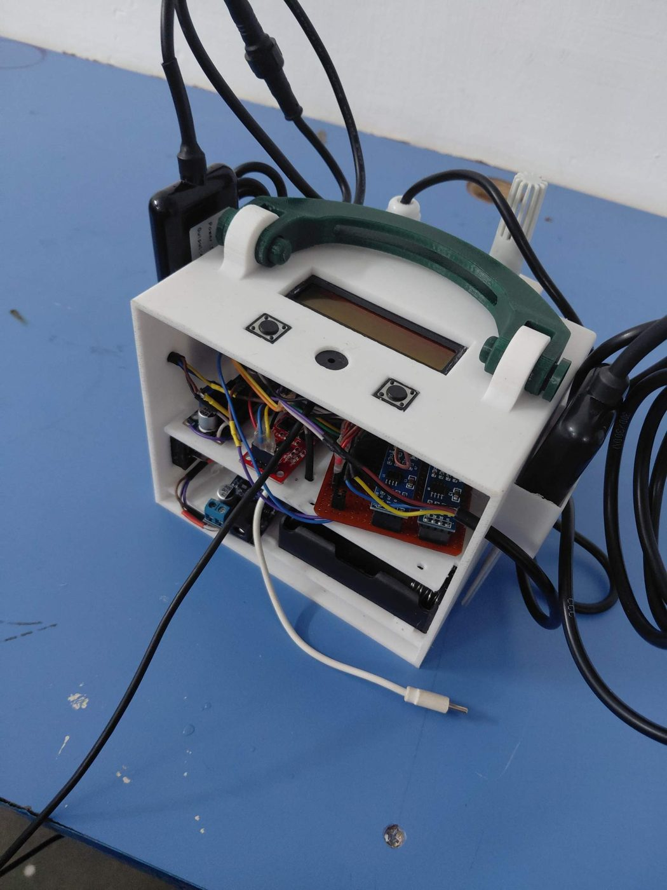

## The product

The complete node: a 3D-printed enclosure with a carry handle, an LCD and two page buttons on the lid, the soil probe on one side and the air temperature/humidity sensor on the other.

| | |
|---|---|
| 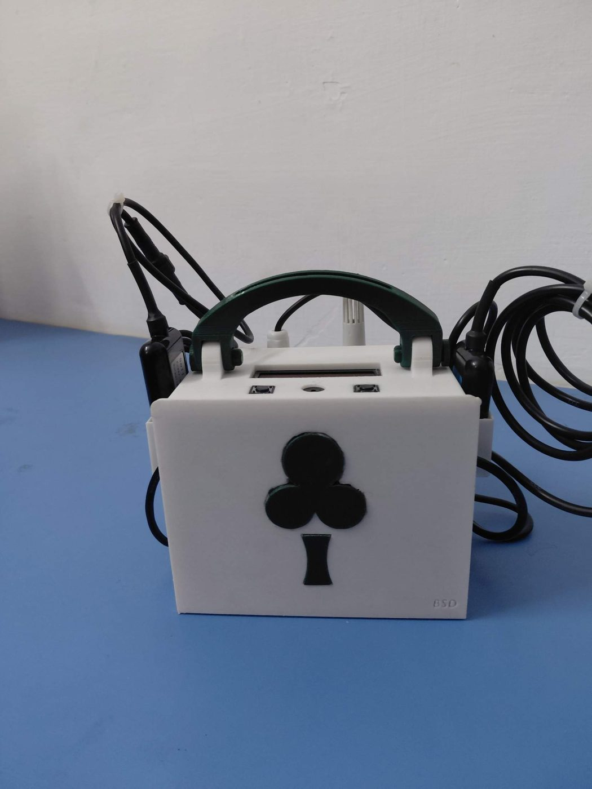 | 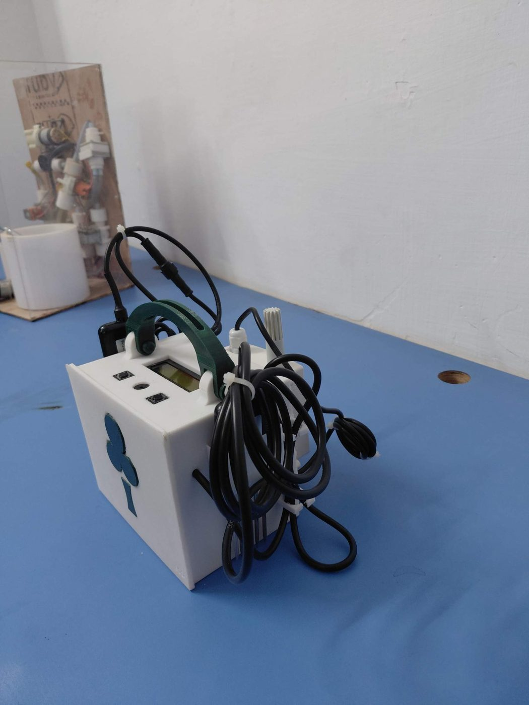 |
| **Front.** Logo panel, handle, LCD and buttons on the lid. | **Back.** Cables from the probes are tied down on both sides. |
| 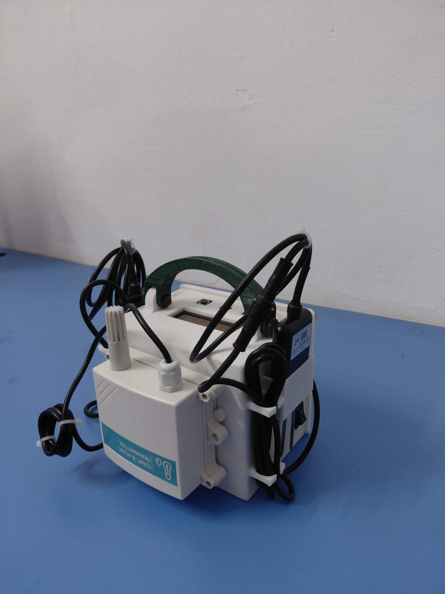 | 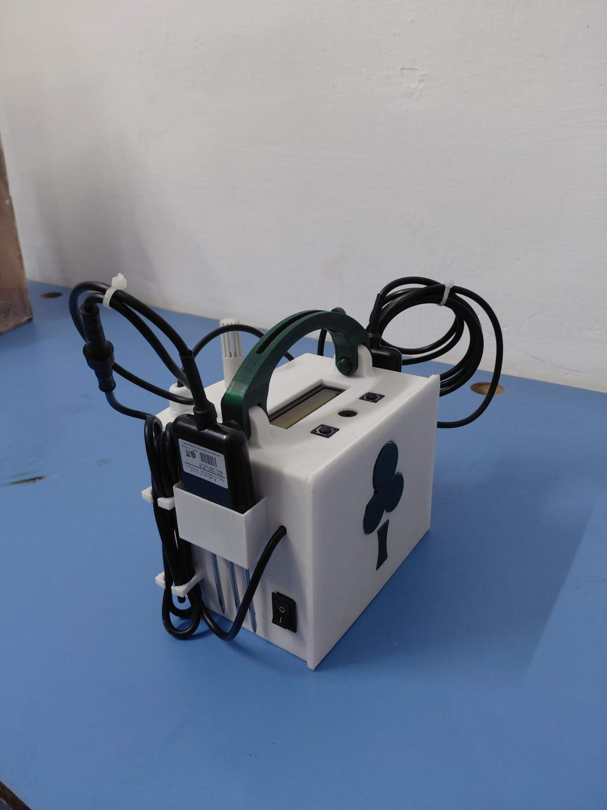 |
| **Air side.** JXBS-3001-TH-RS temperature and humidity transmitter. | **Soil side.** Soil probe in its holder, power switch below it. |

Lid: 16x2 LCD, two page buttons and a buzzer.

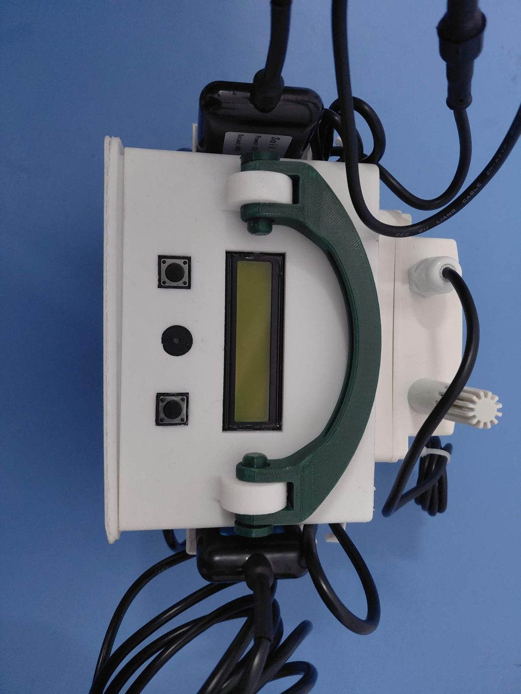

### Inside

Two shelves. The upper shelf holds the ESP32-S3 board, RS485 modules and converters. The lower shelf holds the 18650 battery holder and the power module.

| | |
|---|---|
| 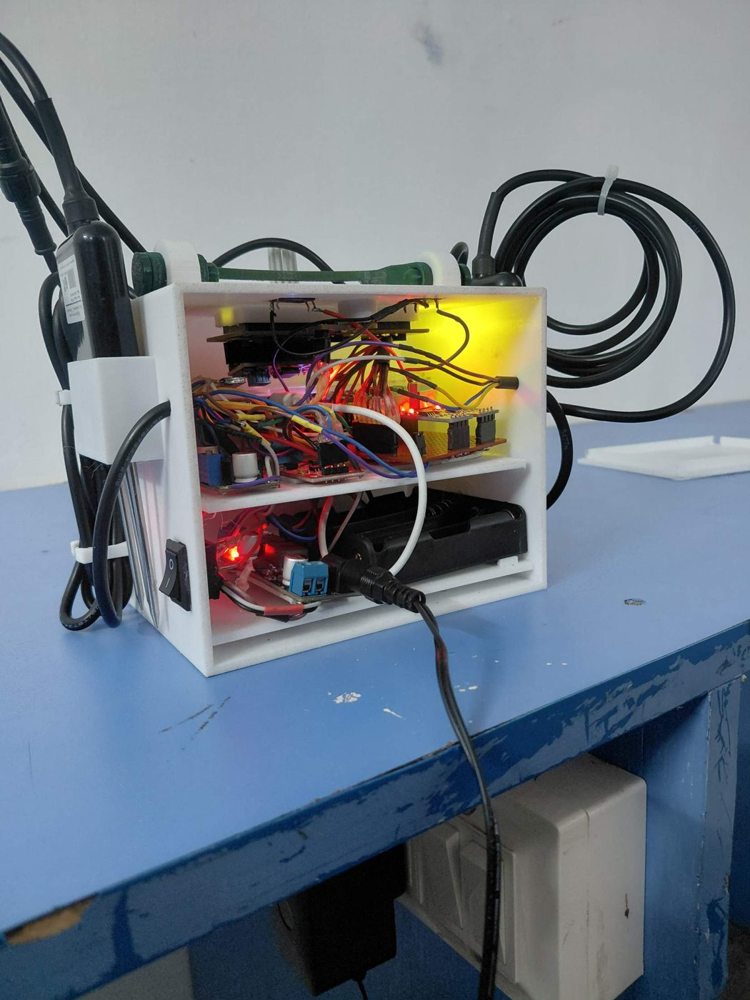 | 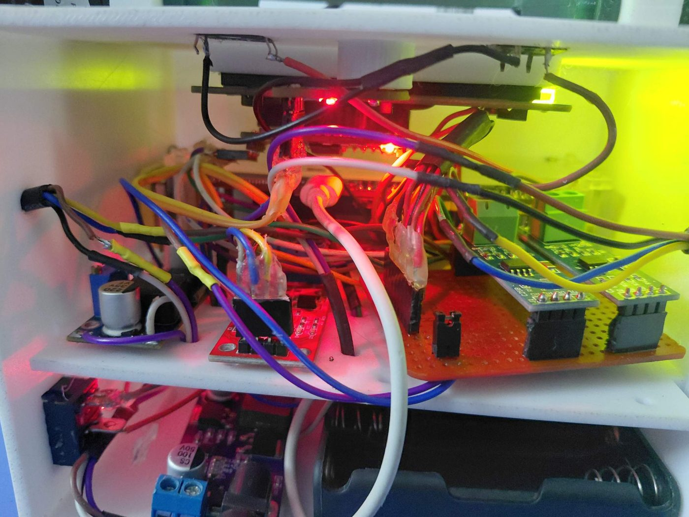 |
| 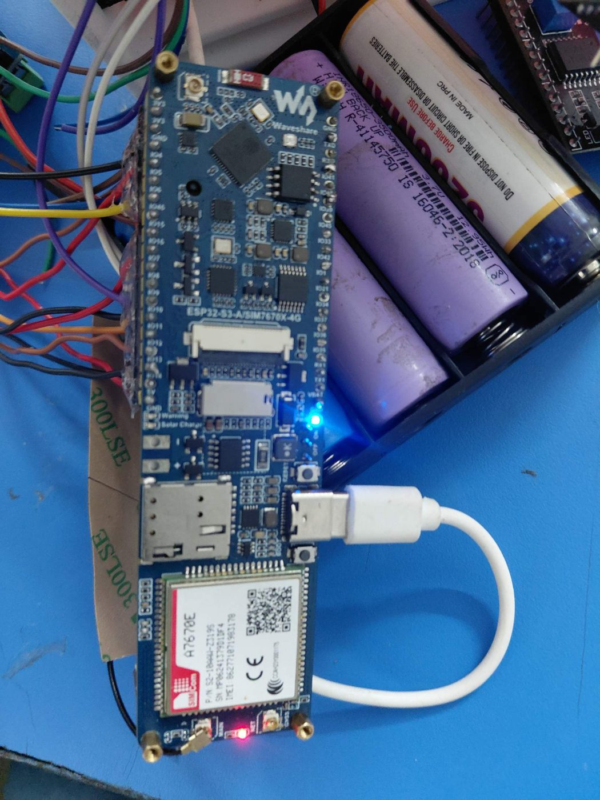 | 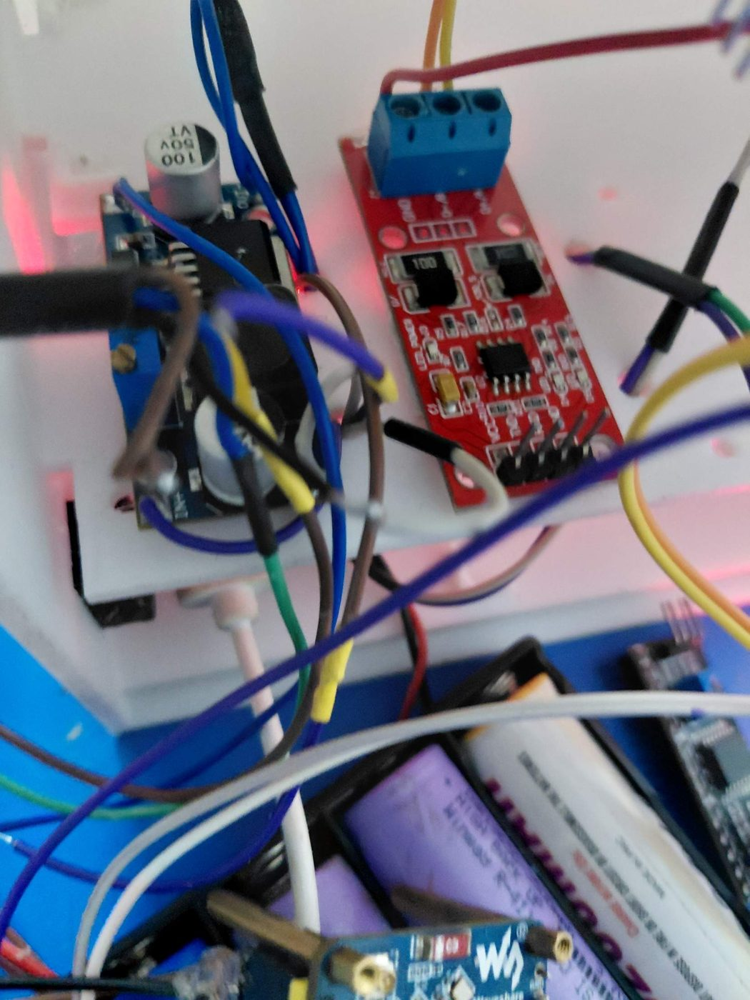 |
| 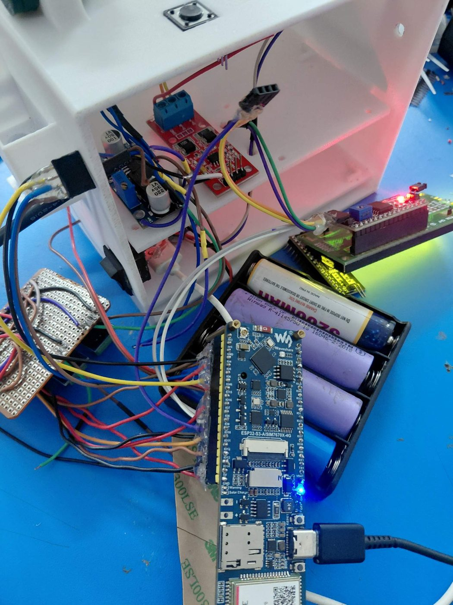 | 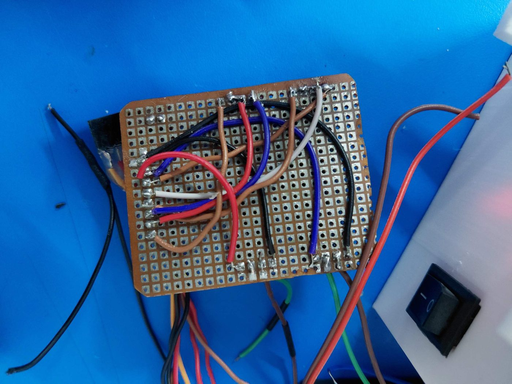 |

More build photos and the parts list are in [docs/01-hardware.md](docs/01-hardware.md).

## Status (6 Nov 2026)

The node firmware with the real sensors is implemented and working, and the prototype has been handed over to the supervisor. The working real-sensor sketch is **not in this repository yet**; it will be added as `firmware/soil_node/`.

| Part | State |
|---|---|
| Enclosure, LCD, 2 buttons, buzzer, power | Built |
| Real-sensor node firmware | Implemented and working (reported 6 Nov 2026). Source to be added to this repo. |
| Simulated node firmware (`soil_node_sim`) | Works on the board. Kept for app development and demos. |
| Real-sensor template (`soil_node_api`) | Early template, superseded by the working firmware. Never run on hardware as written. |
| Android app (Flutter) | Steps 1 to 5 verified on a Galaxy A36. Source is in a separate project, see [docs/05-app.md](docs/05-app.md). |
| Handover | Prototype handed to the supervisor (6 Nov 2026) |

Details and the to-do list are in [docs/07-status-and-roadmap.md](docs/07-status-and-roadmap.md).

## Repository layout

```
firmware/soil_node_sim/    Simulated node: fake sensor values, real Wi-Fi, API, LCD, buttons, buzzer
firmware/soil_node_api/    Real-sensor firmware template (Modbus RS485), not yet tested
cad/                       SolidWorks enclosure files (assembly and parts), see cad/README.md
tools/mock_esp_server.py   PC mock of the node API for app development
docs/                      Hardware, wiring, firmware, API contract, app, testing, status
docs/photos/               Photos of the build
```

## Quick start (no sensors needed)

1. Arduino IDE with the ESP32 core 3.x. Install the library **LiquidCrystal I2C** (Frank de Brabander).
2. Open `firmware/soil_node_sim/soil_node_sim.ino`. Set: Board **ESP32S3 Dev Module**, USB CDC On Boot **Enabled**, PSRAM **Disabled**, Upload Speed **115200**.
3. Upload. If it fails with "No serial data received", put the board in download mode (hold BOOT, tap RESET, release BOOT) and close the Serial Monitor.
4. On a phone, join Wi-Fi `SoilNode-XXXX` (password `soilnode123`) and open `http://192.168.4.1/api/readings`. JSON appears and `seq` keeps increasing.
5. Install the app and open it. See [docs/05-app.md](docs/05-app.md).

No board at hand: run `python3 tools/mock_esp_server.py` and point the app at `http://<PC-IP>:8080`.

## Documentation

1. [Hardware and parts](docs/01-hardware.md)
2. [Wiring and pin map](docs/02-wiring-and-pins.md)
3. [Firmware](docs/03-firmware.md)
4. [API contract (ESP to app)](docs/04-api-contract.md)
5. [Android app](docs/05-app.md)
6. [Testing](docs/06-testing.md)
7. [Status and roadmap](docs/07-status-and-roadmap.md)
8. [Design notes (power budget, two versions)](docs/08-design-notes.md)
9. [Troubleshooting log](docs/09-troubleshooting.md)

## Notes

- The sensor values in `soil_node_sim` are made up. Never present them as measurements.
- The crop ranges in the app are approximate and need review by an agronomist.
- The NPK sensor estimates nutrients from conductivity, so its mg/kg values are indicative only.
- No licence has been chosen yet. Add a `LICENSE` file before sharing the repo publicly.
