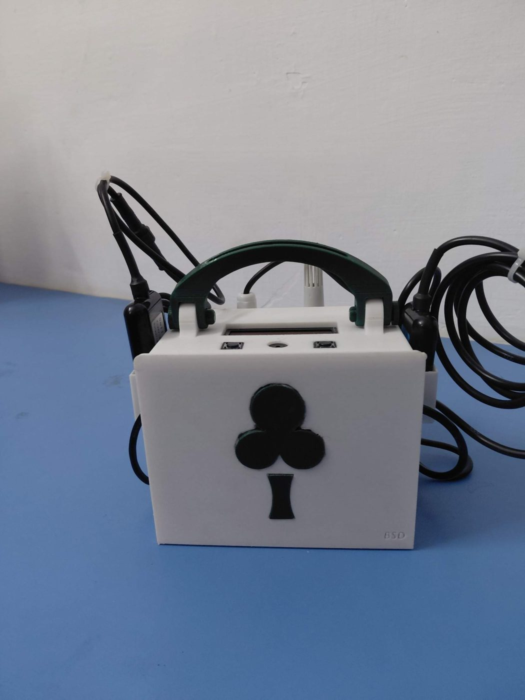
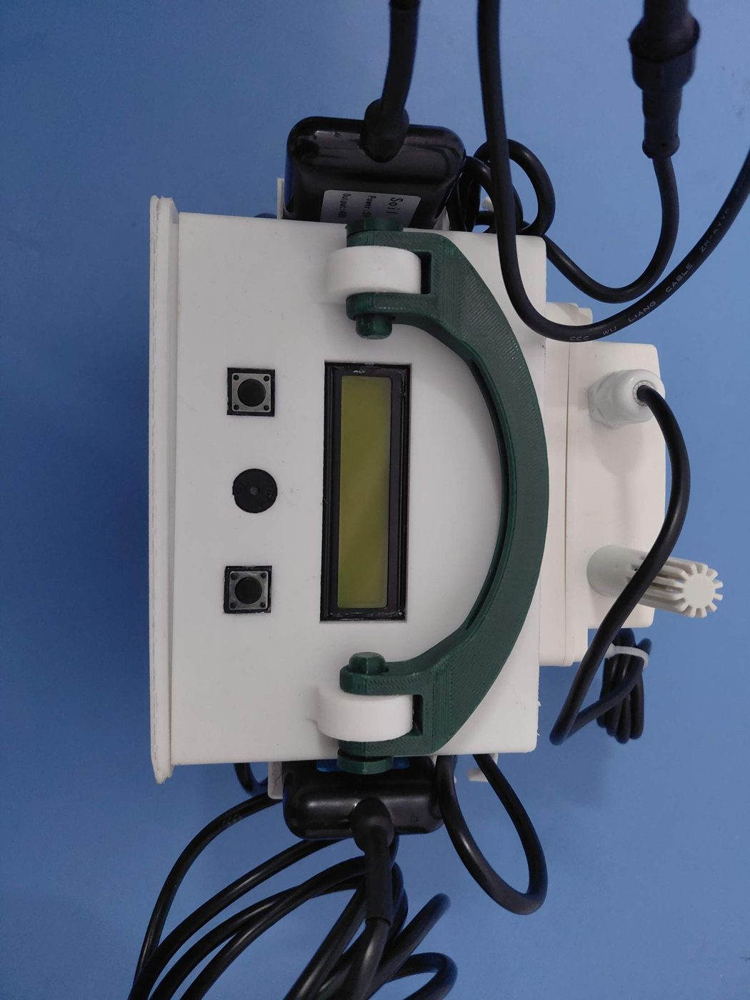
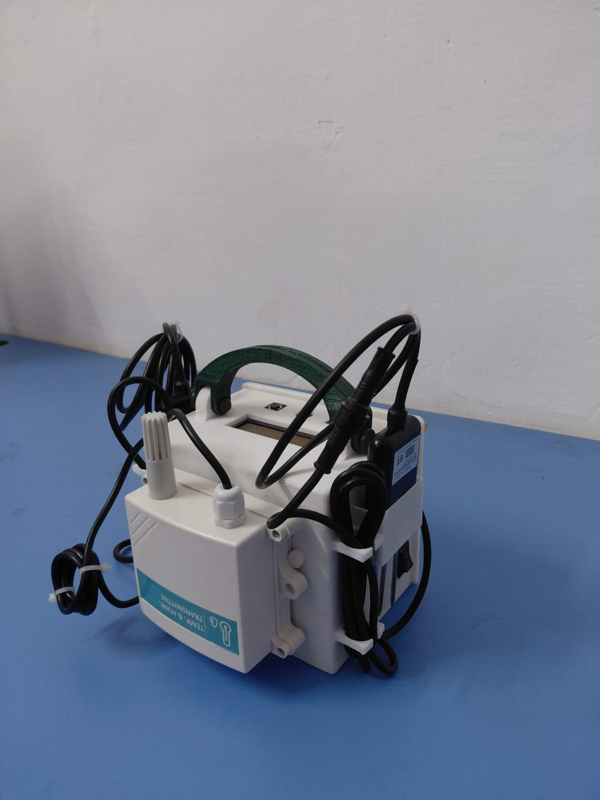
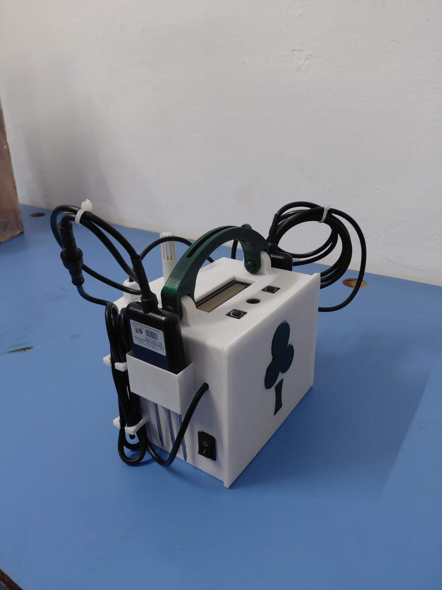
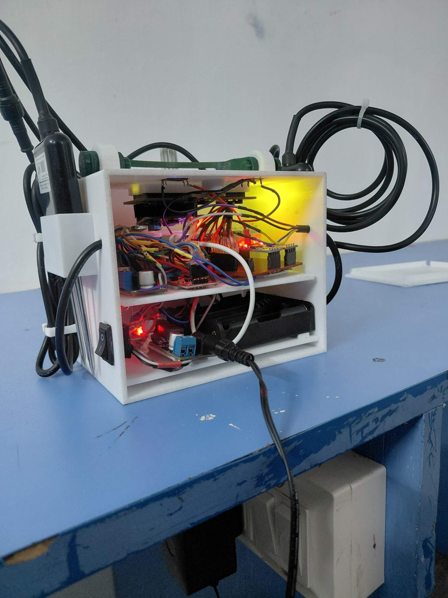
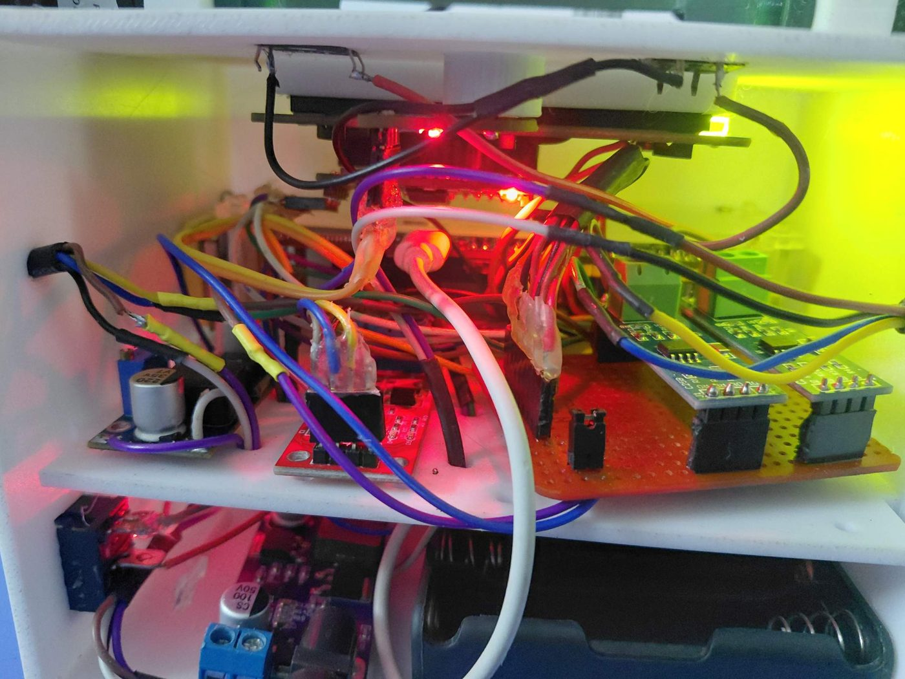
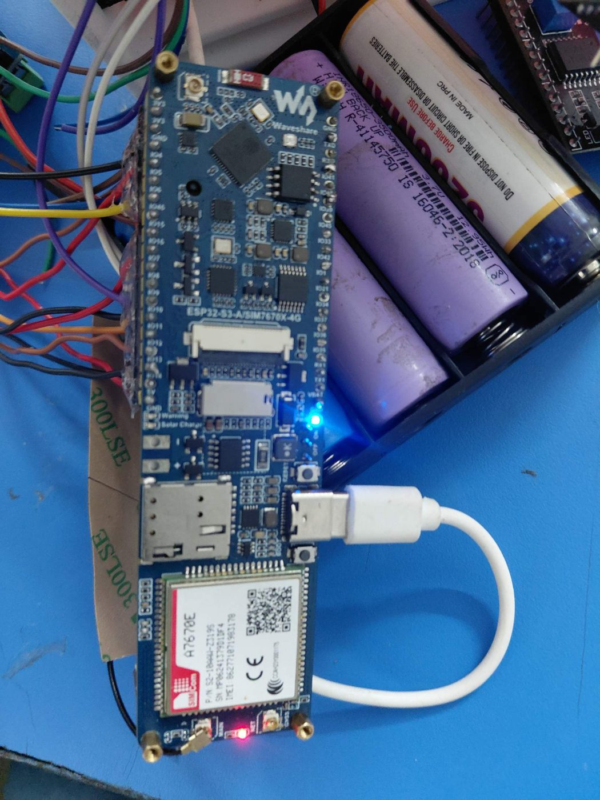
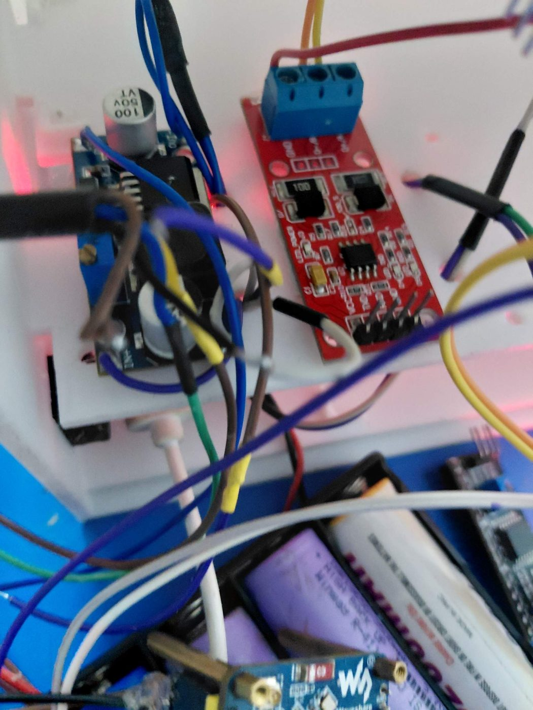
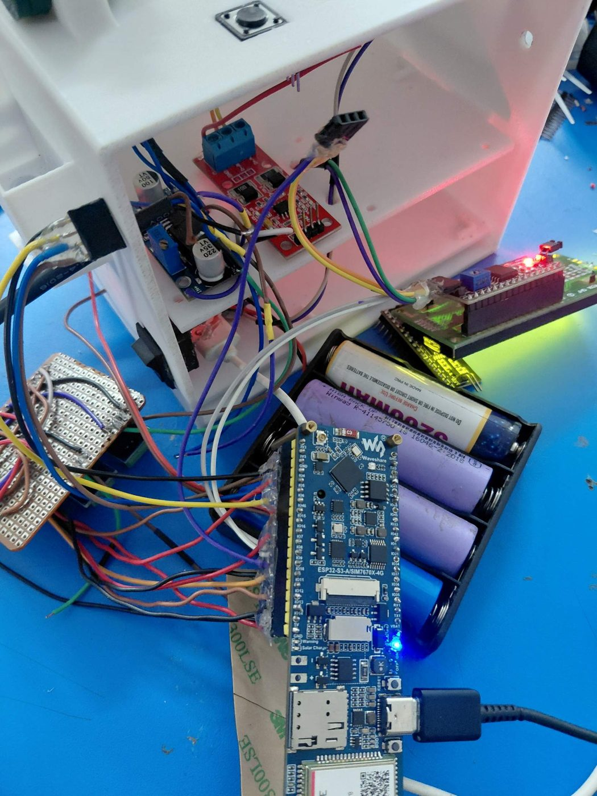
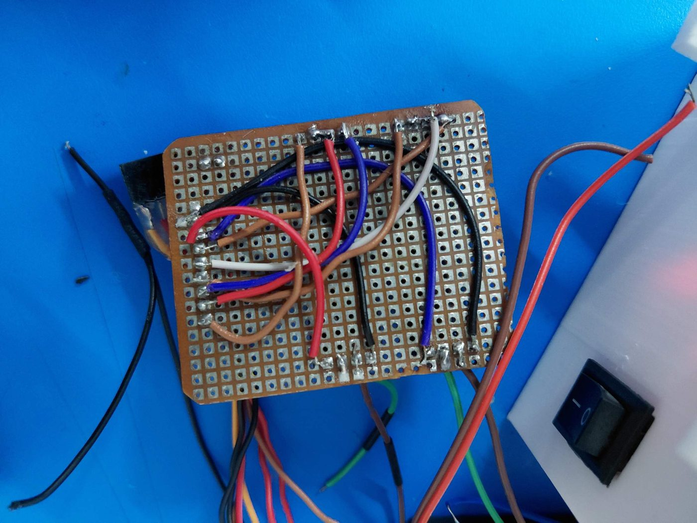

# 1. Hardware and parts

## Parts

| Part | Model | Role |
|---|---|---|
| Controller | Waveshare ESP32-S3-A7670E-4G (silkscreen ESP32-S3-A/SIM7670X-4G) | Used as a plain ESP32-S3 over Wi-Fi. No SIM, 4G DIP switch OFF. |
| Air temperature and humidity | JXBS-3001-TH-RS (RS485 Modbus) | Housed in the white transmitter box on the side |
| Soil moisture, soil temperature, pH | ZTS-3001-TR-THPH-N01 (RS485 Modbus) | Probe in a holder on the side. No EC. |
| N, P, K | JXBS-3001-NPK-RS (RS485 Modbus) | Label on this unit: "Power 5V, Output 485" |
| Analog soil moisture | Generic capacitive/resistive module | Cross-check for the ZTS |
| Display | 16x2 LCD with I2C backpack (address 0x27) | Sensor pages |
| Controls | 2 push buttons, rocker switch | Page up/down, system power |
| Buzzer | Passive buzzer | Feedback beeps |
| RS485 interface | Two red MAX485-type modules on a perfboard | One per bus |
| Power | 4 x 18650 holder, buck converter, boost module, barrel jack | See below |

Sensor datasheets: the ESP32-S3-A7670E-4G board PDF, the ESP32-S3 datasheet and the JXBS-3001-TH manuals were used while building. They are manufacturer documents and are not copied into this repository.

## Enclosure

CAD source files are in [`../cad`](../cad/README.md).

3D-printed white box with a green carry handle. Two shelves: electronics on the upper shelf (board, RS485 modules, converters), battery holder and power module on the lower shelf. LCD, two buttons and the buzzer are on the lid. The soil probe sits in a printed holder on one side, the air sensor box on the other.

| | |
|---|---|
|  |  |
|  |  |
|  |  |
|  |  |
|  |  |

## Power

- Current build: a 4-cell 18650 holder feeds the board through a buck converter. An XL6009 boost module is on hand for the 12 V that the air sensor may need. A rocker switch cuts the whole system. A barrel jack input is fitted (see the enclosure photos).
- NPK supply: the user's unit is labelled 5 V and measures 5 V at the brown (+) and black (-) wires. The manufacturer manual says 12 to 24 V for the standard version, so check the label of each unit before powering it.
- RS485 driver boards run from 5 V. Their receiver output (RO) must go through a 1 kOhm series plus 2 kOhm to GND divider before it reaches a 3.3 V ESP32 pin.
- The ESP32-S3 board has its own USB-C. Do not connect USB and the battery pack to the 5 V input at the same time without checking the board's power path.

## Sensor wiring colours (NPK)

Brown = +, black = -, yellow = A, blue = B. Default 9600 baud, address 1.

## Board settings

- 4G DIP switch OFF (modem unused, saves power).
- Do not use GPIO 33 (it controls the board's battery switch).
- Keep the camera connector empty.
